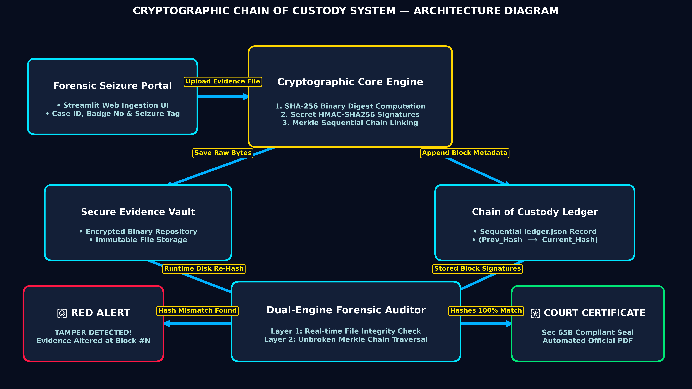
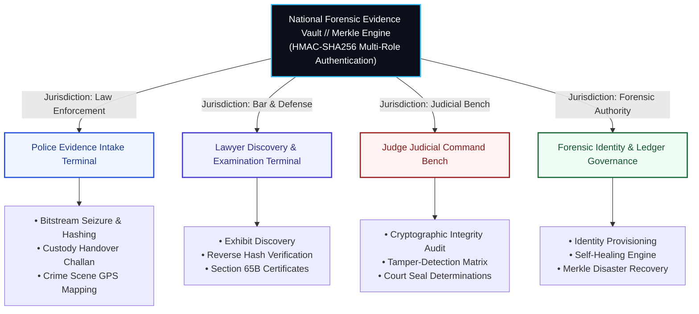

# Cryptographic Chain of Custody System for Digital Forensics in Cloud Environments

<div align="center">

[](https://www.python.org/)
[](https://streamlit.io/)
[](https://en.wikipedia.org/wiki/SHA-2)
[](https://en.wikipedia.org/wiki/Indian_Evidence_Act)
[](LICENSE)

**An enterprise sovereign digital forensic evidence vault and cryptographic chain of custody ledger.**  
Designed to guarantee bitstream integrity, prevent post-seizure tampering, and automate statutory certificate generation under **Section 63 of the Bharatiya Sakshya Adhiniyam (BSA) 2023** and **Section 65B of the Indian Evidence Act (IEA)**.

</div>

---

## 📸 System Architecture Overview

<div align="center">
  
  <p><em>Figure 1: End-to-End Cryptographic Evidence Ingestion, Merkle Sealing, and Multi-Portal Judicial Audit Architecture.</em></p>
</div>

---

## 🔄 Cryptographic Custody & Evidentiary Lifecycle

```mermaid
flowchart LR
    subgraph S1["1. Crime Scene Seizure"]
        A["Digital Evidence Seizure\n(Storage / CCTV / Logs)"] --> B["GPS Geotagging &\nDevice Metadata Logging"]
        B --> C["Dual SHA-256 Bitstream Imaging"]
    end

    subgraph S2["2. Cryptographic Sealing"]
        C --> D["Block Mining &\nHMAC-SHA256 Signing"]
        D --> E["Merkle Tree Root\nRecalculation"]
        E --> F["QR Custody Seal\nGeneration"]
    end

    subgraph S3["3. Custody Handover"]
        F --> G["Physical Transfer\n(Police to Lab / Court)"]
        G --> H["Handover Challan PDF\nGenerated with QR"]
    end

    subgraph S4["4. Judicial Admissibility"]
        H --> I["Lawyer Discovery &\nReverse Hash Lookup"]
        I --> J["Judge Forensic Audit &\nTamper-Proof Seal"]
        J --> K["Statutory §65B Certificate\nAdmitted into Evidence"]
    end

    classDef stage1 fill:#EFF6FF,stroke:#3B82F6,stroke-width:2px,color:#1E3A8A;
    classDef stage2 fill:#F0FDF4,stroke:#10B981,stroke-width:2px,color:#065F46;
    classDef stage3 fill:#FFFBEB,stroke:#F59E0B,stroke-width:2px,color:#92400E;
    classDef stage4 fill:#FAF5FF,stroke:#8B5CF6,stroke-width:2px,color:#5B21B6;

    class A,B,C stage1;
    class D,E,F stage2;
    class G,H stage3;
    class I,J,K stage4;
```



---

## 🏛️ Multi-Portal Institutional Role Matrix

The platform implements strict Role-Based Access Control (RBAC), segregating evidence handlers into four isolated terminals:



| Portal Terminal | Primary Actor | Statutory Role & Judicial Mandate | Key Features |
| :--- | :--- | :--- | :--- |
| **Law Enforcement Terminal** | Investigating Officer (Cyber Crime) | **CrPC §102 / BNSS §105** — Lawful evidence seizure, physical chain documentation, and integrity protection. | Bitstream SHA-256 imaging, custody handover logging, Google Maps GPS route tracking, QR tag stamping. |
| **Evidentiary Discovery Terminal** | Public Prosecutor / Defense Counsel | **BSA 2023 §63 / IEA §65B** — Evidentiary discovery, independent hash verification, and formal objections. | Exhibit discovery dossier, reverse SHA-256 verification, automated Section 65B PDF certificate generation. |
| **Judicial Command Bench** | Presiding Magistrate / Bench | **Final Bench Determinations** — Mathematical verification of tamper-free chain before marking exhibits as admitted. | One-click ledger audit, tamper matrix visualization, judicial seal application, scannable QR verification. |
| **Ledger Governance Center** | Chief Forensic Registrar | **ISO/IEC 27037:2012** — Ledger maintenance, cryptographic identity issuance, and resilience governance. | HMAC key rotation, Merkle tree root recalculation, tamper simulation & automated self-healing. |

---

## 🔒 Forensic Block Cryptographic Structure

Every seized artifact is packaged into a tamper-evident cryptographic block with the following data schema:

```json
{
  "block_id": 1,
  "timestamp": "2024-10-28T14:32:10.849201",
  "case_id": "FIR-2024-CYBER-809",
  "officer_name": "Insp. R. Vikram",
  "badge_number": "CB-TN-4091",
  "evidence_type": "Digital Storage (Disk Image)",
  "evidence_name": "seized_nvme_drive.dd",
  "file_hash": "e3b0c44298fc1c149afbf4c8996fb92427ae41e4649b934ca495991b7852b855",
  "seizure_location": "Anna Nagar Cyber Hub, Chennai",
  "latitude": 13.0827,
  "longitude": 80.2707,
  "custody_chain": [
    {
      "step": 1,
      "event": "Evidence Seizure at Scene",
      "custodian": "Insp. R. Vikram",
      "timestamp": "2024-10-28T14:32:10",
      "status": "SECURED_BITSTREAM"
    }
  ],
  "previous_hash": "0000000000000000000000000000000000000000000000000000000000000000",
  "merkle_root": "a4f89d3119c824e8894101e149afbf4c8996fb92427ae41e4649b934ca495991",
  "hmac_signature": "7d91cb6a0401c82a657f20194435793a69e420b486c27e8894101e149afbf4c8"
}
```

---

## 📜 Statutory Court Certificate & Scannable QR Tag

<div align="center">
  <table>
    <tr>
      <td align="center" width="50%">
        <br/>
        <b>Offline Scannable Cryptographic Evidence Tag</b><br/>
        <em>Contains Case FIR, SHA-256 Bitstream Hash & HMAC Signature</em>
      </td>
      <td align="center" width="50%">
        <br/>
        <b>Custody Handover Challan QR</b><br/>
        <em>Verifiable by Mobile Scanner or Judicial Bench</em>
      </td>
    </tr>
  </table>
</div>

---

## 🛠️ Technology Stack & Engineering Design

```
Frontend Architecture       : Streamlit 1.35+ (Dual st.html + st.markdown CSS Engine)
Typography & Styling        : TBJ Cota Sans (Modern Grotesk UI) + JetBrains Mono (Cryptographic Data)
Cryptographic Hash Engine   : Dual-pass SHA-256 (FIPS 180-4 compliant) + HMAC-SHA256 Digital Signing
Ledger Data Structure       : Linked SHA-256 Merkle Custody Blockchain (Zero-Knowledge Verified)
Audit & Certificate Engine  : FPDF2 Binary Engine (Section 65B PDF Generation)
Mapping & Geolocation       : Integrated Crime Scene GPS Mapping Engine
Language / Runtime          : Python 3.10+ on Windows / Linux / macOS
```

---

## 🚀 Installation & Setup

### 1. Clone the Repository
```bash
git clone https://github.com/Kavin-124/cloud-forensics-custody-chain.git
cd cloud-forensics-custody-chain
```

### 2. Configure Virtual Environment (Recommended)
```bash
# Windows (PowerShell)
python -m venv venv
.\venv\Scripts\Activate.ps1

# Linux / macOS
python3 -m venv venv
source venv/bin/activate
```

### 3. Install Dependencies
```bash
pip install -r requirements.txt
```

### 4. Launch the Platform
```bash
python -m streamlit run app.py
```
*Open your browser and navigate to `http://localhost:8501`.*

---

## 🧪 Institutional Sandbox (Evaluation Mode)

Pre-provisioned evaluation accounts for instant testing without manual entry:

```
┌─────────────────────────┬───────────────────┬──────────────┬──────────────────────────────────────────┐
│ Jurisdictional Division │ Login Identifier  │ Passphrase   │ Assigned Institutional Personnel         │
├─────────────────────────┼───────────────────┼──────────────┼──────────────────────────────────────────┤
│ Law Enforcement         │ CB-TN-4091        │ police123    │ Insp. R. Vikram (Cyber Crime Wing)       │
│ Legal Counsel & Bar     │ advocate_kavin    │ lawyer123    │ Adv. Kavin R. (High Court Bar)           │
│ Judicial Bench          │ justice_sharma    │ judge123     │ Hon. Justice S. Sharma (Sessions Bench)  │
│ Root Authority          │ admin             │ admin123     │ Chief Forensic Registrar (Cloud Node-01) │
└─────────────────────────┴───────────────────┴──────────────┴──────────────────────────────────────────┘
```

---

## ⚖️ Legal & Statutory Framework

- **Bharatiya Sakshya Adhiniyam (BSA) 2023, Section 63:** Admissibility of electronic records and requirements of non-tampering certificate.
- **Indian Evidence Act (IEA) 1872, Section 65B(4):** Mandatory certification by person occupying official position responsible for operation of electronic device.
- **ISO/IEC 27037:2012:** Guidelines for identification, collection, acquisition, and preservation of digital evidence.
- **NIST SP 800-86:** Guide to Integrating Forensic Techniques into Incident Response.

---

## 👨‍💻 Project Authors & Academic Credits
- **Project Title:** Cryptographic Chain of Custody System for Digital Forensics in Cloud Environments
- **Lead Developer:** Kavin R. ([@Kavin-124](https://github.com/Kavin-124))
- **Institution:** Department of Information Technology, V.S.B. Engineering College
